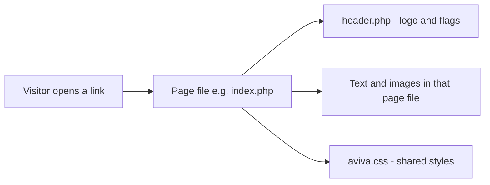

# A-VIVA website — guide for non-technical editors

This folder is the **A-VIVA Language School** website (Frankfurt). When someone visits the site in a browser, the server **opens the right page file** and shows it to them.

You do **not** need to understand programming. This guide tells you **which files change what you see**, and **which folders are safe to ignore**.

For running the site on your computer with Laragon, see also: [`docs/LOCAL_DEV.md`](docs/LOCAL_DEV.md).

The live site is at **https://a-viva.net**. Changes are stored in **GitHub** and can be published automatically to Host Europe when you push to the `main` branch (see [Publishing changes](#publishing-changes) below).

---

## The idea in one picture

Imagine the website as a **house**:

| Part | What it is | Folder / file |
|------|------------|----------------|
| **Front door / home page** | Main entry with menu and welcome text | `index.php` (English), `de/index.php` (German) |
| **Other rooms** | Programs, prices, contact, etc. | `programs.php`, `prices.php`, … and `de/` copies |
| **Ceiling lamp in every room** | Logo + language flags | `header.php` / `de/header.php` |
| **Paint and furniture style** | Colours, fonts, layout — **one file for both languages** | `aviva.css` |
| **Photo albums on the wall** | Old picture galleries | `galeries/` |
| **A second building next door** | Old Joomla CMS (separate system) | `aviva/` |

Most pages work the same way:

1. The page file (e.g. `programs.php`) has the **menu** and **main text**.
2. Near the top it includes the header: `<?php include("header.php") ?>`.
3. The page links to **`aviva.css`** for styling (German pages use `../aviva.css` to reach the same file).
4. The browser shows **header + page content** together.



---

## Languages: English and German only

The site has **two** language versions:

| If visitors use this URL | Edit files in |
|--------------------------|---------------|
| `a-viva.net/index.php` (English) | **Root folder** — files directly in `www/` |
| `a-viva.net/de/index.php` (German) | **`de/`** folder |

**Important:** English and German are **separate copies** of almost the same pages. If you change text on the English prices page, also change `de/prices.php` if you want German to match.

The **flag images** in the header switch between English and German:

- English [`header.php`](header.php) — links to `index.php` and `de/index.php`
- German [`de/header.php`](de/header.php) — links to `../index.php` and `index.php`

---

## Stylesheet (unified)

There is **one** stylesheet for the whole brochure site:

| File | Used by |
|------|---------|
| [`aviva.css`](aviva.css) | All English pages (`href="aviva.css"`) |
| Same file | All German pages (`href="../aviva.css"`) |

Edit **`aviva.css` once** — colours, fonts, logo size, menu layout — and both languages update. There is no separate `de/aviva.css` anymore.

---

## PHP files you **can** edit to change the website

These are the main page files. Each one matches an item in the top menu (or a linked page).

### English site (root folder)

| File | What visitors see | What you might change |
|------|-------------------|------------------------|
| `index.php` | **Home** — welcome text, menu, “Who we are” | Main home content |
| `faq.php` | **FAQ** | Questions and answers |
| `programs.php` | **Programs** — courses and packages | Program descriptions, links |
| `activities.php` | **Activities** — sports, culture, events | Activity lists and descriptions |
| `travels.php` | **Travels** — trips and travel info | Trip text and links |
| `accommodation.php` | **Housing** | Housing options and text |
| `student.php` | **Services** — help for students | Service descriptions |
| `work.php` | **Jobs** — work and scholarships | Job-related text |
| `prices.php` | **Prices** — fees and packages | Price tables and wording |
| `register.php` | **Register** — how to sign up | Registration info |
| `contact.php` | **Contact** — address, map link | Address, directions, contact details |
| `links.php` | **Links** — useful websites | Link list |
| `newclasses.php` | New classes information | Class info |
| `day.php` | “Typical day” schedule | Daily schedule text |
| `chart.php` | Language level chart | Chart content |
| `class_breakdown.php` | Class / level breakdown | Class structure text |
| `homework_breakdown.php` | Homework breakdown | Homework info |

### German site (`de/` folder)

Same page names as English, plus a few **German-only** helpers:

| File | Notes |
|------|--------|
| `de/index.php`, `de/programs.php`, `de/prices.php`, … | German versions of the main menu pages |
| `de/faq.php` | German FAQ |
| `de/newclasses.php` | German “new classes” |
| `de/nicejobs.php` | German jobs-related page (no English equivalent in root) |
| `de/rde.php` | German **contact form** (fields, subjects, thank-you messages) |
| `de/r.php` | Registration sidebar text for German register page |
| `de/register.php` | German register page |

---

## PHP “helper” files — shared pieces

Edit with care — they affect multiple pages.

| File | Role | When to edit |
|------|------|----------------|
| `header.php` | Top banner: **logo image** + **EN/DE flag links** | Logo area or flag links |
| `de/header.php` | Same for German URLs | Same, with paths for `/de/` |
| `r.php` | HTML chunk for **registration** (PDF links, payment text) | Registration sidebar on English site |
| `de/r.php` | German registration sidebar | German register page |
| `de/rde.php` | Full **German contact form** | Form fields and messages |
| `k.php` | Contact form snippet (English) | If used on `contact.php` |
| `k-de.php` | German contact helper | If used on German contact flow |

**Example — German register page:**

```
de/register.php  →  includes de/header.php  →  may include de/r.php
```

---

## PHP files for developers (not daily text edits)

| File | What it does | Should you edit? |
|------|----------------|------------------|
| `formk.php` | **reCAPTCHA** check on forms | Developer only — needs secret keys |
| `payment.php` | **Stripe** payment processing | Developer only — payment secrets |
| `container.php` | Alternate page layout wrapper | Rarely needed |
| `de/k-old.php` | Old backup of contact helper | **Do not use** on live site |
| `tests.php` | Test variant | Not for production |
| `pics/activities.php` | Duplicate content in wrong folder | Real page is `activities.php` in root |

The **`aviva/`** folder is **Joomla 1.5** (old CMS with its own admin and database). It is **not** the same as `index.php` / `programs.php`. The main school site is the PHP pages in the root and `de/`. GitHub deploy **excludes** `aviva/` from automatic uploads.

---

## Files that are **not** PHP but you will edit often

| Type | Where | Used for |
|------|--------|----------|
| **Styles** | `aviva.css` only | Background colour, fonts, menu, logo size — **both languages** |
| **Images** | `pics/` | Logo (`logo.png`), side images, flags (`en.gif`, `de.gif`) |
| **PDFs for download** | `registration/` | Registration forms, terms |
| **More PDFs** | `PDF/`, `downloads/` | Calendars, flyers, brochures |
| **Legal** | `impressum.html`, privacy PDF in root | Impressum, data protection |
| **Server rules** | `.htaccess` | URL/server behaviour — developer only |

---

## Other folders — what they are for

### Part of the **main school website**

| Folder | Role |
|--------|------|
| `pics/` | Images shared by English and German pages |
| `registration/` | PDF registration forms |
| `downloads/` | Calendars, audio, extra downloads |
| `PDF/` | Older PDF documents |
| `galeries/` | Old photo galleries (direct links, not main menu) |
| `quizpics/` | Images for quiz content |

### **Archive / not live**

| Folder | Role |
|--------|------|
| `_archive/` | Old snapshots — do not edit for live content |
| `docs/` | Developer notes (local setup, etc.) |

### **Separate system (Joomla)**

| Folder | Role |
|--------|------|
| `aviva/` | Joomla 1.5 — thousands of files, separate admin. Not updated by the main deploy workflow. |

### **Server / tool folders**

| Folder | Role |
|--------|------|
| `cgi-bin/`, `.well-known/` | Server scripts, SSL verification |
| `.github/` | GitHub Actions deploy workflow (developers) |

---

## How the main pieces link together

```
index.php  (English home)
de/index.php  (German home)
        │
        ├── header.php / de/header.php  (logo + EN | DE flags)
        ├── aviva.css  (one stylesheet, both languages)
        └── pics/  (shared images)
        │
        ├── programs.php, prices.php, contact.php, …
        └── de/programs.php, de/prices.php, de/contact.php, …
```

---

## Publishing changes

The site is hosted on **Host Europe**. The repo uses **GitHub Actions** to upload changed files over FTPS when you push to **`main`**.

**Typical workflow:**

1. Edit files locally (e.g. in Laragon).
2. Commit and push to GitHub.
3. Check **GitHub → Actions → Deploy to Host Europe** for a green checkmark.
4. Visit **https://a-viva.net** and press **Ctrl+F5** to verify.

FTP credentials live in **GitHub Secrets**, not in the repo. The deploy skips `aviva/`, `_archive/`, `docs/`, and `.env`.

You can also run the deploy manually: **Actions → Deploy to Host Europe → Run workflow**.

---

## Quick cheat sheet — “I want to change…”

| I want to change… | English | German |
|-------------------|---------|--------|
| Home page text | `index.php` | `de/index.php` |
| Course / program info | `programs.php` | `de/programs.php` |
| Activities | `activities.php` | `de/activities.php` |
| Trips | `travels.php` | `de/travels.php` |
| Housing | `accommodation.php` | `de/accommodation.php` |
| Prices | `prices.php` | `de/prices.php` |
| Registration info | `register.php`, maybe `r.php` | `de/register.php`, `de/r.php` |
| Contact details | `contact.php` | `de/contact.php` |
| German contact form | — | `de/rde.php` |
| Logo / language flags | `header.php` | `de/header.php` |
| Colours and fonts | `aviva.css` | **same file** — `aviva.css` |
| Registration PDF | `registration/*.pdf` | same folder (shared) |
| Side column picture | `pics/` (e.g. `pics/home.jpg`) | same `pics/` folder (shared) |

---

## Summary

- **Main website** = PHP pages in the **root** (English) and **`de/`** (German) — **no other language folders**.
- **`header.php`** / **`de/header.php`** = logo and EN/DE flags.
- **`aviva.css`** = one shared stylesheet for both languages.
- **`galeries/`** and **`aviva/`** = separate corners of the project; main deploy does not push `aviva/`.
- **`_archive/`** = old material — not for live edits.

When in doubt, edit the **page file** that matches the menu item you see in the browser, and update the matching file in the other language if needed. Ask a developer before moving folders, renaming files, or changing `.htaccess` / deploy settings.
