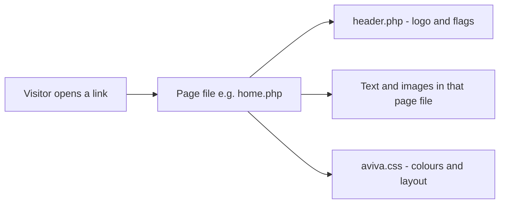

# A-VIVA website — guide for non-technical editors

This folder is the **A-VIVA Language School** website (Frankfurt). Think of it like a **big folder of pages** on a computer. When someone visits your website in a browser, the server **opens the right page file** and shows it to them.

You do **not** need to understand programming. This guide tells you **which files change what you see**, and **which folders are safe to ignore** when you tidy the project.

For running the site on your computer with Laragon, see also: [`docs/LOCAL_DEV.md`](docs/LOCAL_DEV.md).

---

## The idea in one picture

Imagine the website as a **house**:

| Part | What it is | Folder / file |
|------|------------|----------------|
| **Front door** | First page visitors may see | `index.php` |
| **Living room** | Main home page with the menu | `home.php` |
| **Same rooms in other languages** | German, French, etc. copies | `de/`, `fr/`, `it/`, … |
| **Ceiling lamp in every room** | Logo + language flags (same on many pages) | `header.php` |
| **Paint and furniture style** | Colours, fonts, layout | `aviva.css` |
| **Photo albums on the wall** | Old picture galleries | `galeries/` |
| **A second building next door** | Old Joomla CMS (separate system) | `aviva/` |

Most pages work the same way:

1. The page file (e.g. `programs.php`) has the **menu** and **main text**.
2. Near the top it says: “plug in the header” → `<?php include("header.php") ?>`.
3. The browser shows **header + page content** together.



---

## Which language am I editing?

| If visitors use this URL | Edit files in |
|--------------------------|---------------|
| `yoursite.com/home.php` (English) | **Root folder** — files directly in `www/` |
| `yoursite.com/de/home.php` (German) | **`de/`** folder |
| `yoursite.com/fr/home.php` (French) | **`fr/`** folder |
| Same pattern for Italian, Portuguese, Japanese, Turkish, Spanish | **`it/`**, **`pt/`**, **`jp/`**, **`tr/`**, **`sp/`** |

**Important:** English and German (and other languages) are **separate copies** of almost the same pages. If you change text on the English home page, you must also change the German home page in `de/home.php` if you want both languages to match.

The **flag images** in `header.php` link between languages (English, German, French, etc.).

---

## PHP files you **can** edit to change the website

These are the main “page” files. Each one is one item in the top menu (or a special page linked from the site).

### English site (root folder)

| File | What visitors see | What you might change |
|------|-------------------|------------------------|
| `index.php` | Welcome / splash screen; redirects to home after a few seconds | Welcome text, link “Enter Here” |
| `home.php` | **Home** — welcome text, “Who we are”, benefits | All paragraphs and tables in the middle |
| `faq.php` | **FAQ** — questions and answers | Questions and answers |
| `programs.php` | **Programs** — courses and packages | Program descriptions, prices text, links |
| `activities.php` | **Activities** — sports, culture, events | Activity lists and descriptions |
| `travels.php` | **Travels** — trips and travel info | Trip text and links |
| `accommodation.php` | **Housing** — where students stay | Housing options and text |
| `student.php` | **Services** — help for students | Service descriptions |
| `work.php` | **Jobs** — work and scholarships | Job-related text |
| `prices.php` | **Prices** — fees and packages | Price tables and wording |
| `register.php` | **Register** — how to sign up | Registration info (cancellation rules, etc.) |
| `contact.php` | **Contact** — address, map link, opening feel | Address, directions, Skype, map link |
| `news.php` | **News** — announcements | News items, dates, links |
| `links.php` | **Links** — list of useful websites | Link list |
| `newclasses.php` | New classes information (if linked) | Class info |
| `nicejobs.php` | “Nice jobs” / work-related extra page | Content on that page |
| `class_breakdown.php` | Class / level breakdown | Class structure text |
| `homework_breakdown.php` | Homework breakdown | Homework info |
| `day.php` | “Typical day” schedule | Daily schedule text |
| `chart.php` | Language level chart | Chart content |
| `chinaearthquake.php` | One old special fundraising page | Only if you still use this page |

### German site (`de/` folder)

Same names as above, plus a few **only in German**:

| File | Notes |
|------|--------|
| `de/home.php`, `de/programs.php`, … | German versions of the main pages |
| `de/faq.php` | German FAQ |
| `de/newclasses.php` | German “new classes” |
| `de/nicejobs.php` | German jobs-related page |
| `de/rde.php` | German **contact form** (big form with subject dropdown) |
| `de/register.php` | German register page (text about cancellation) |

Other language folders (`fr/`, `it/`, `pt/`, `jp/`, `tr/`, `sp/`) have the **same page names** as English/German for the main menu. Edit the matching file in that folder for that language.

---

## PHP “helper” files — small pieces used inside pages

You **can** edit these, but they affect **many pages at once**. Be careful.

| File | Role | When to edit |
|------|------|----------------|
| `header.php` | Top banner: logo (Flash), **language flag links** | Change flag links, or replace logo area |
| `r.php` | Chunk of HTML for **registration** (payment text, links to PDF forms) | Used inside `register.php` on some language sites via `<?php include("r.php") ?>` |
| `k.php` | Meant for **contact form** snippet on some pages | Often empty; check `contact.php` in each language |
| `k-de.php` | German-related contact helper | If used on German contact page |
| `de/rde.php` | Full **German contact form** | Form fields, email subjects, “thank you” messages |
| `de/header.php` | German folder’s own header (flags point to `/de/…`) | Same as `header.php` but for German URLs |

**How they connect (example — Register page in Japanese):**

```
jp/register.php  →  includes jp/header.php  →  includes jp/r.php (registration text)
```

---

## PHP files that **do work behind the scenes** (developers, not daily text edits)

| File | What it does | Should you edit? |
|------|----------------|------------------|
| `registration.php` (in some language folders) | Sends registration form data by **email** when someone submits a form | Only with a developer — wrong settings = forms break |
| `formk.php` | Checks **reCAPTCHA** (“I’m not a robot”) on forms | Developer — needs secret keys |
| `payment.php` | **Stripe** payment processing | Developer — contains payment secrets |
| `container.php` | Alternate page layout wrapper | Rarely needed |
| `test.php` (inside `de/`, `fr/`, etc.) | Test copy of a page | Do not use for the live site |
| `k-old.php` | Old backup of contact helper | **Do not use** — keep for history or delete later with developer |
| `register_oldwithflash.php` | Old registration page with Flash | **Old** — use `register.php` instead |
| `tests.php` | Looks like another test/home variant | Treat as test, not main site |
| `pics/activities.php` | Huge duplicate of activities content in wrong folder | **Confusing** — real page is `activities.php` in root |

---

## Files that are **not** PHP but you will still edit often

| Type | Where | Used for |
|------|--------|----------|
| **Styles** | `aviva.css` (and `aviva.css` inside language folders) | Background colour, fonts, menu look |
| **Images** | `pics/` | Photos, banners, menu side images (`home.jpg`, `register.jpg`, flags `en.gif`, `de.gif`, …) |
| **PDFs for download** | `registration/` | Registration forms, terms & conditions |
| **More PDFs** | `PDF/`, `downloads/` | Calendars, flyers, old brochures |
| **Legal pages** | `impressum.html` | Impressum (legal notice) |
| **Privacy PDF** | `DATENSCHUTZERKLÄRUNG-_-DATA-PROTECTION.pdf` (root) | Data protection |
| **JavaScript** | `Scripts/AC_RunActiveContent.js` | Old Flash support — usually leave as-is |
| **Server rules** | `.htaccess` | How the server handles URLs — developer only |

---

## Other folders — what they are for

### Part of the **main school website**

| Folder | Role | Link to rest of site |
|--------|------|----------------------|
| `pics/` | Pictures and Flash files for headers, side images | Pages use paths like `pics/home.jpg` |
| `registration/` | PDF registration forms linked from `r.php` / register pages | Linked as `/registration/….pdf` |
| `downloads/` | Calendars, audio (`avamari.mp3`), extra downloads | Linked from pages or PDFs |
| `PDF/` | Many older PDF documents (events, concerts, forms) | Linked from news/activities or old links |
| `galeries/` | **Old photo galleries** (HTML + images: sushi, salsa, squash, …) | Separate mini-sites; opened by direct links, not the main menu |
| `quiz/` | Small **quiz / game** area with its own `de/` copy of pages | Separate from main menu; uses `quizpics/` |
| `quizpics/` | Images for the quiz | Used by `quiz/` |
| `sushiflyer/` | Flyer HTML/material | Marketing / print related |

### **Copies, tests, backups — not the live site**

| Folder | Role | Recommendation |
|--------|------|----------------|
| `_backup/` | Old snapshots of pages (2014, 2016, …) | Move to `archive/` or off the server — do not edit for live content |
| `test/` | Full duplicate site for testing | Keep for developers; visitors should not use it |
| `regtest/` | Registration form tests (Flash experiments) | Archive or delete after developer review |
| `cn/` | Almost empty (only `header.php`) | Finish or remove |

### **Separate big system (Joomla CMS)**

| Folder | Role |
|--------|------|
| `aviva/` | **Joomla 1.5** — thousands of files, own admin panel, database. This is **not** the same as `home.php` / `programs.php`. It was a second way to run a website. |

If you only maintain the classic PHP pages, you can think of `aviva/` as **another product in the same box** — developers decide whether it is still needed.

### **Server / tool folders (do not reorganise without a developer)**

| Folder | Role |
|--------|------|
| `cgi-bin/` | Server scripts |
| `.well-known/` | SSL / domain verification |
| `aviva/administrator/`, `aviva/components/`, … | Joomla internals |

---

## How the main pieces link together

```
index.php  ──(auto redirect)──►  home.php
                                    │
                    ┌───────────────┼───────────────┐
                    ▼               ▼               ▼
              header.php      aviva.css         pics/*.jpg
              (logo, flags)
                    │
        ┌───────────┼───────────┬──────────────┐
        ▼           ▼           ▼              ▼
   programs.php  activities.php  register.php  contact.php
        │                           │              │
        │                           ▼              ▼
        │                        r.php          k.php / rde.php
        │                    registration/*.pdf
        ▼
   links to galeries/, PDF/, downloads/
```

**Language switch:** `header.php` flag links go to `home.php`, `de/home.php`, `fr/home.php`, etc. Each language folder has its own `header.php` with paths adjusted for that language.

---

## Recommendations to make the project neater for developers

These are **suggestions** — do them with a developer so links on the live website do not break.

### 1. Split “live site” from “storage”

Create clear top-level areas (names can be chosen with your developer):

| New area | Move into it |
|----------|----------------|
| `public/` or keep root as live | Only files the website must serve: pages, `pics/`, `aviva.css`, `registration/`, `downloads/` |
| `archive/` | `_backup/`, old `*_old*.php`, `chinaearthquake.php`, `register_oldwithflash.php`, unused `regtest/` |
| `staging/` | `test/` (rename to `staging/` so everyone knows it is not production) |

### 2. One folder per language (already partly done)

You already have `de/`, `fr/`, etc. **Do not** also keep duplicate logic in random places (e.g. `pics/activities.php`). Delete or move duplicates after checking nothing links to them.

### 3. Shared pieces instead of copy-paste

Today, every `home.php` repeats the same menu HTML. Long term, a developer can:

- Put the menu in **one** file (e.g. `includes/menu-en.php`) and `include` it from every English page.
- Same for `header.php` and footers.

That way you change the menu **once**, not on ten pages.

### 4. Rename confusing files

| Current name | Clearer name (example) |
|--------------|-------------------------|
| `r.php` | `register-sidebar-en.php` |
| `k.php` | `contact-form-snippet.php` |
| `rde.php` | `contact-form-de.php` |
| `k-old.php` | Move to `archive/` |

### 5. Group assets

| Current | Suggested |
|---------|-----------|
| PDFs in root + `PDF/` + `downloads/` + `registration/` | `assets/pdf/registration/`, `assets/pdf/marketing/`, `assets/downloads/` |
| All images in `pics/` | `assets/images/` (and update paths in PHP — developer task) |
| `galeries/` | `archive/galleries/` if still needed only for old links |

### 6. Decide fate of Joomla (`aviva/`)

- If the school **no longer uses** Joomla: document that, export anything needed, then move `aviva/` to `archive/joomla-1.5/` so the main project looks like one website, not two.
- If still used: keep it, but add a short `aviva/README.md` saying “admin URL” and “do not touch for main brochure site”.

### 7. Remove or hide Flash-era files

Many pages still reference `.swf` Flash files in `pics/`. Modern browsers do not show them. Plan with a developer to replace header/register Flash with normal images or HTML.

### 8. Add a simple map file for editors

Keep this `README.md` updated when you add a new page. Optional: a one-page `EDITORS.md` with only the table “file → what it changes”.

### 9. Use version control (Git)

The project is not a git repo yet. A developer can run `git init` so every change is tracked and you can undo mistakes.

### 10. Do not delete before checking links

Before moving or deleting any file, search the project for its name (e.g. `register_form00.swf`). Old links in PDFs or emails may still point to old paths.

---

## Quick cheat sheet — “I want to change…”

| I want to change… | Open this file (English) | German |
|-------------------|---------------------------|--------|
| Home page text | `home.php` | `de/home.php` |
| Course / program info | `programs.php` | `de/programs.php` |
| Activities | `activities.php` | `de/activities.php` |
| Trips | `travels.php` | `de/travels.php` |
| Housing | `accommodation.php` | `de/accommodation.php` |
| Prices | `prices.php` | `de/prices.php` |
| Registration info | `register.php` and maybe `r.php` | `de/register.php`, `de/r.php` |
| Contact details | `contact.php` | `de/contact.php` |
| German contact form | — | `de/rde.php` |
| Logo / language flags | `header.php` | `de/header.php` |
| Colours and fonts | `aviva.css` | `de/aviva.css` |
| Registration PDF | `registration/*.pdf` | same folder |
| Side column picture on a page | `pics/` (e.g. `pics/home.jpg`) | same `pics/` folder (shared) |

---

## Summary

- **Main website** = PHP page files in the **root** (English) and in **`de/`**, **`fr/`**, etc. (other languages).
- **`header.php`** = shared top; **`aviva.css`** = look; **`pics/`** = images.
- **`r.php`**, **`rde.php`**, **`registration.php`** = registration and contact **pieces** or **email sending** — edit text with care.
- **`galeries/`**, **`quiz/`**, **`aviva/`** = separate corners of the project.
- **`_backup/`**, **`test/`**, **`regtest/`** = clutter for a tidy repo — archive them, do not mix with live edits.

When in doubt, change text only in the **page file** that matches the menu item you see in the browser, and ask a developer before moving folders or renaming files.
